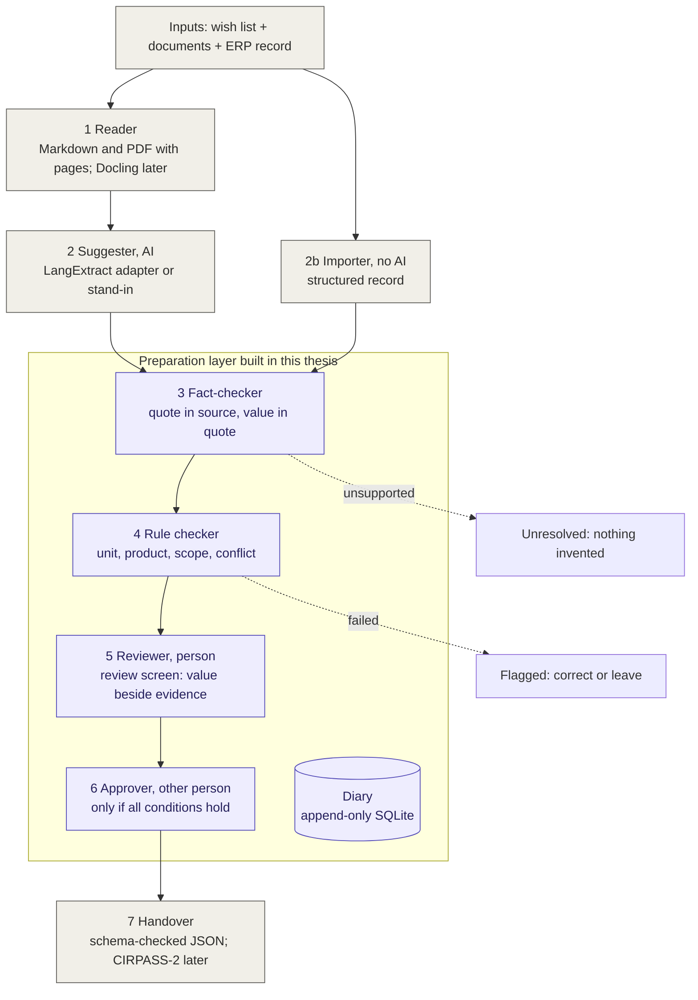

# Architecture (v0.3)

Gray: existing tools, reused. Purple: the preparation layer built in this thesis.

## Layers in the code

| Layer | File | Responsibility |
|---|---|---|
| Configuration | `config/*.yaml` | What is needed, and how it is checked |
| Sources | `sources.py` | Load documents and records, fingerprint them |
| Suggestion | `extract.py` | Produce candidate values with evidence |
| Evidence | `verify.py` | Find the quote in the source; record position and fingerprint |
| Rules | `checks.py` | Support, identity, unit, scope, type, composition, conflict |
| Authority | `states.py` | Who may move a record, and under which conditions |
| Workflow | `service.py` | The only entry point; calls everything in the right order |
| Diary | `audit.py` | Append-only record of every step |
| Handover | `export.py`, `schemas/` | Build and validate the package |
| Review screen | `app/review_app.py` | Streamlit; calls the service only |
| Evaluation | `scripts/evaluate.py`, `config/evaluation_scenarios.yaml` | Scenarios, repeated runs, outcome vs expectation |
